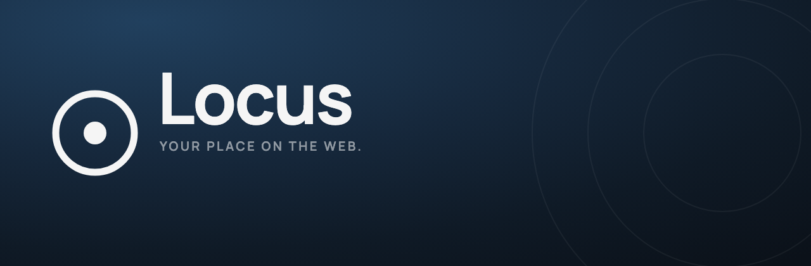
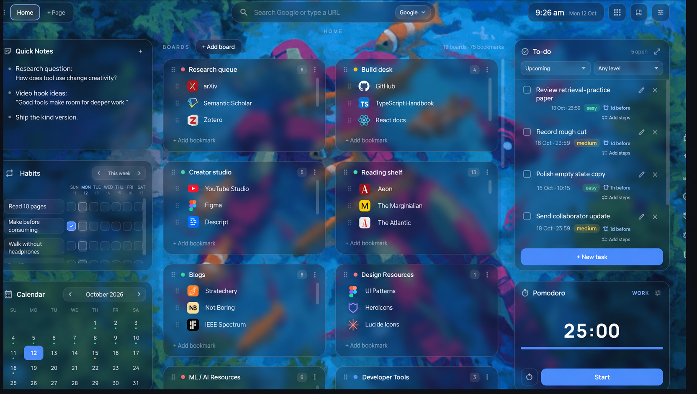

<p align="center">
  
</p>

<p align="center">
  
  
  
</p>

# Locus

Your browser gives you a new tab dozens of times a day. Most of the time, it
gives you nowhere useful to begin.

**Locus turns that moment into a calm home for the things you are trying to
keep track of** — bookmarks, tasks, habits, notes, and the next clear step.

<p align="center">
  
</p>

## Why Locus

Work gets scattered across tabs. Small intentions disappear. Tomorrow starts
with the same unfinished things you meant to remember yesterday.

Locus keeps the useful parts of your day together on every new tab:

- bookmark boards in the middle;
- quick notes, habits, and a calendar on the left;
- today’s to-dos and Pomodoro focus on the right;
- a private Daily Compass that helps you begin with context;
- separate pages for different parts of your life, with a Recycle Bin for safe recovery.

Everything stays in the browser. There is no account, server, analytics, or
runtime network dependency.

## Try it locally

Locus is currently loaded as an unpacked Chrome extension.

```bash
git clone https://github.com/atkareprathmesh/Locus.git
cd Locus
npm install
npm run build
```

Then open `chrome://extensions`, enable **Developer mode**, choose **Load
unpacked**, and select the generated `dist/` folder. Open a new tab and keep
Locus when Chrome asks to confirm the new-tab provider.

To update an existing install:

```bash
git pull
npm run build
```

Then press the reload button on the Locus card in `chrome://extensions`.

## Privacy by default

Locus stores personal data in the browser’s local extension storage. Bookmark
boards sync with Chrome’s bookmark store; notes, tasks, habits, journal entries,
and settings do not leave the browser.

## Develop

```bash
npm run dev      # local preview at http://localhost:5173
npm run lint
npm run build
```

Built with Vite, React, TypeScript, and Manifest V3.

## License

MIT
